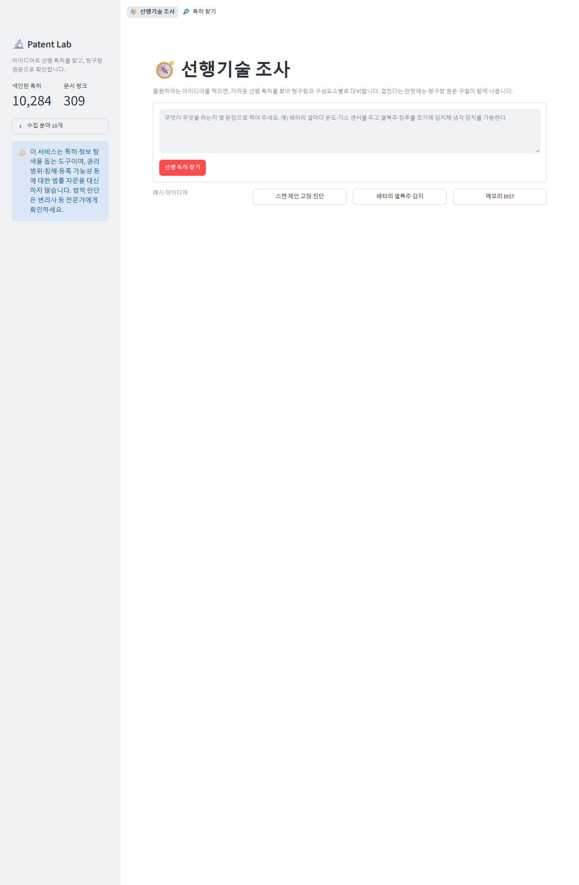
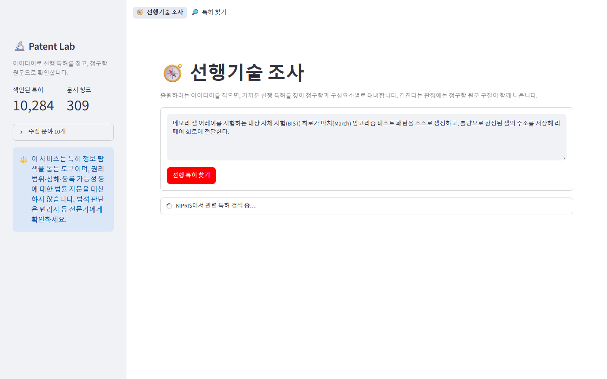
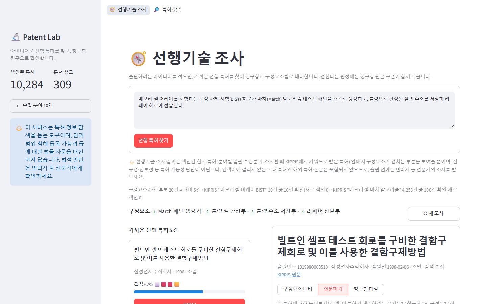
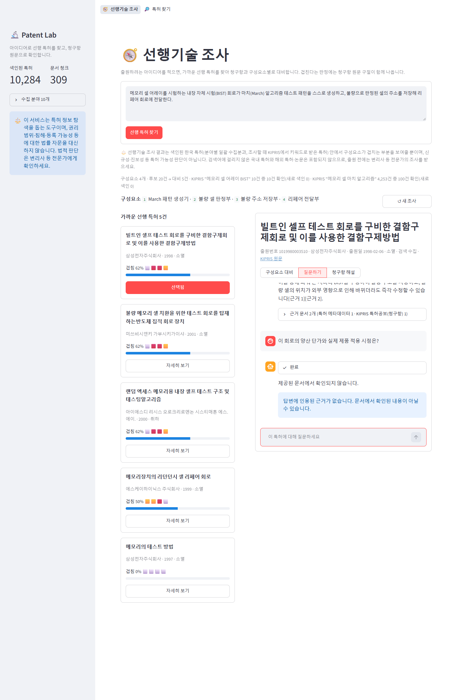
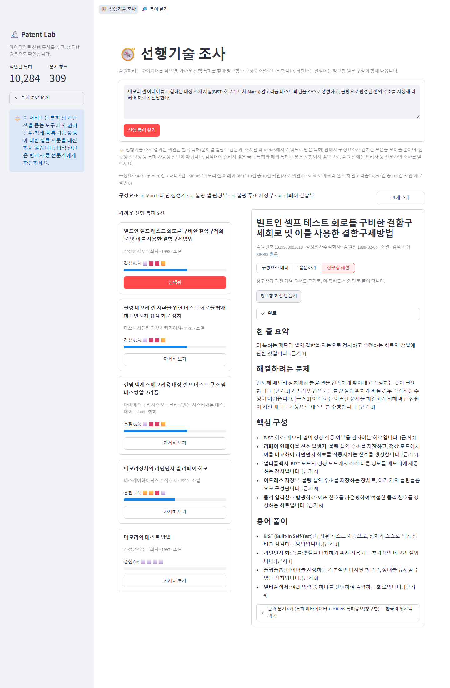
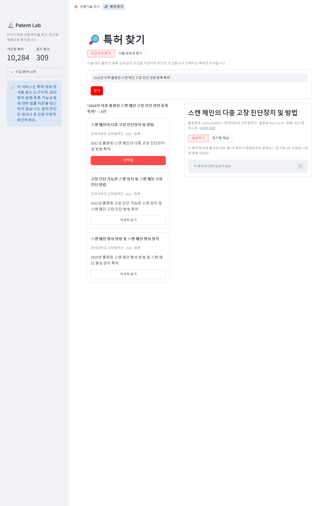
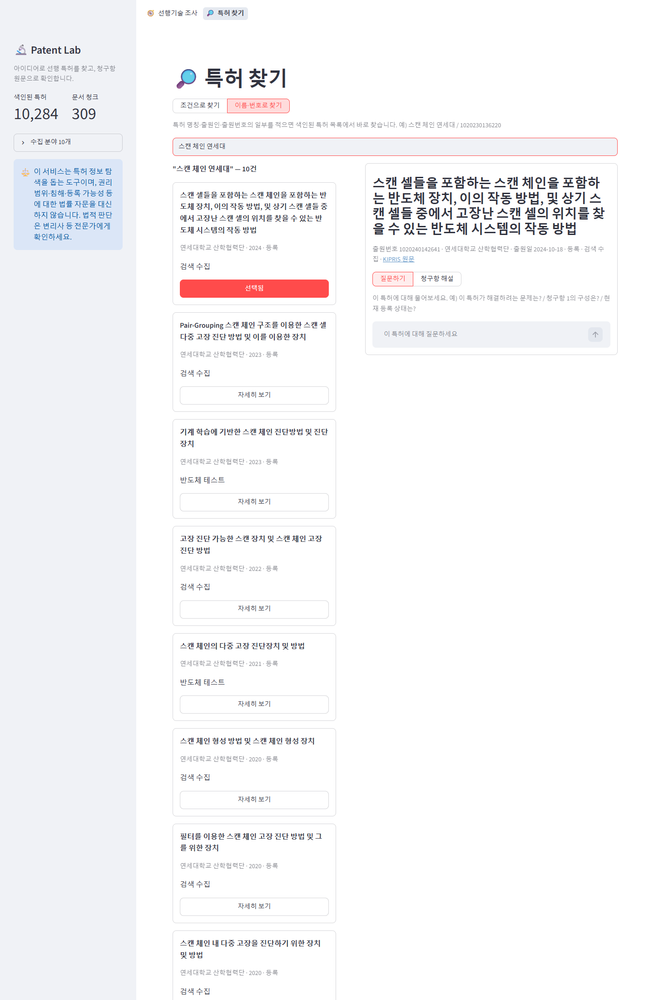
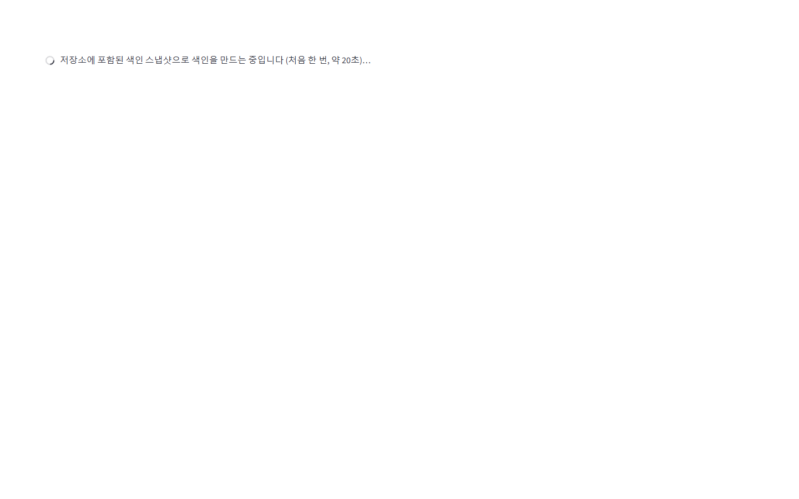
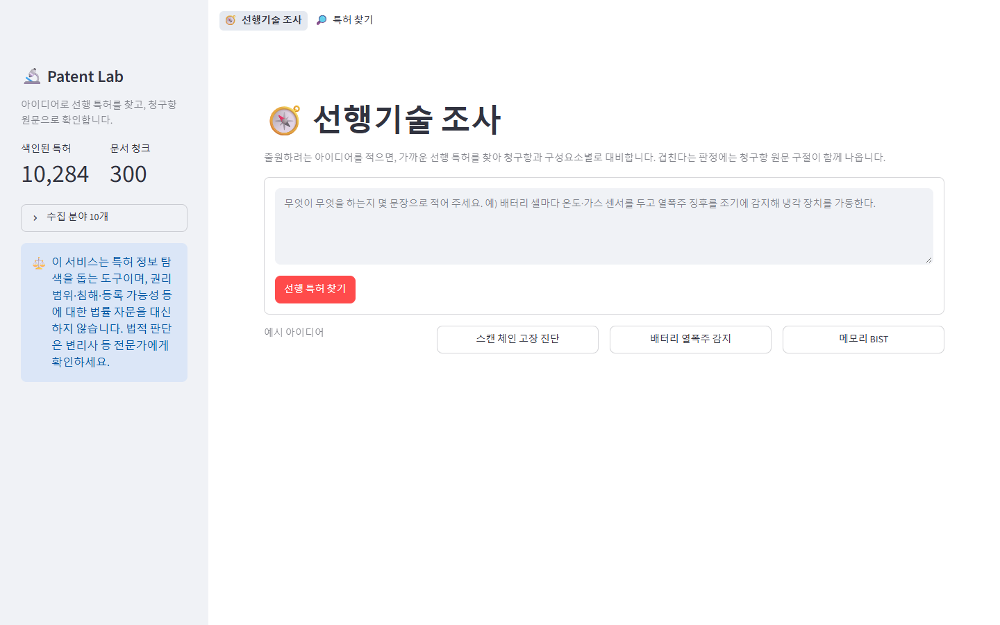
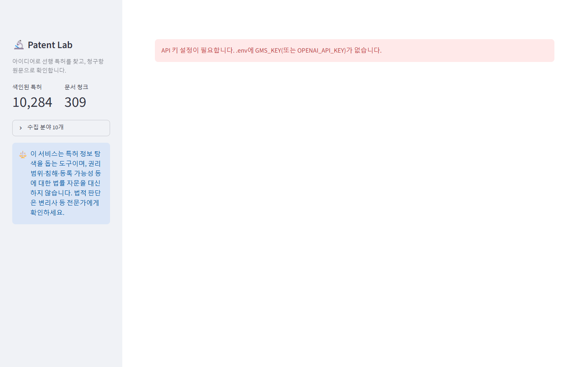

# Patent Lab — 선행기술 조사 RAG 서비스

한국 특허를 대상으로, **선행 특허 조사**와 특허 질의응답을 **특허 공보(요약·청구항)와 위키백과에서 찾은 근거만으로** 해 주는 RAG 서비스입니다.

- **데이터**: 반도체 테스트(IPC G01R 31/3183) 전체 985건 + 8개 분야(반도체 소자·전지·컴퓨팅·인공지능·통신·의료 진단·전기차·재료 분석) 대표 IPC 각 1,000건을 미리 받아 두고, **조사할 때마다 아이디어의 키워드로 KIPRIS 전 분야를 검색해 새 특허를 더합니다.** (현재 10,284건, 그중 검색 수집 1,537건)

**만든 이유** — 특허를 출원하며 선행 특허를 조사할 때, 가장 시간이 드는 일은 비슷한 특허를 찾아 청구항을 하나씩 읽고 "내 아이디어의 어느 구성이 이미 나와 있는지"를 대조하는 것이었습니다. Patent Lab은 아이디어를 입력하면 가까운 선행 특허를 찾아 **구성요소별로 청구항과 대비하고, 겹친다는 판정마다 청구항 원문 구절을 보여줍니다.** 이를 통해 검색어를 다양하게 변경하며 다양한 조건으로 검색 및 청구항을 비교하는 기간을 줄이기 위해 만들었습니다.

- 특허 청구항은 법률 문장이라 읽기 어렵고, 비슷한 특허가 많아 근거 없이 답하면 다른 특허와 섞인 그럴듯한 오답이 나옵니다. ([RAG 전후 비교](docs/f2015_rag_comparison.md): 근거 없는 답은 사실 질문 4개 중 0개 정답, RAG 답은 4개 모두 원문과 일치)
- 이 서비스는 특허 정보 탐색을 돕는 도구이며 **법률 자문을 대신하지 않습니다.** 권리 범위·침해·등록 가능성 판단은 변리사 등 전문가에게 확인하세요.

| 문서 | 내용 |
|---|---|
| [docs/requirements.md](docs/requirements.md) | 요구사항 정의서 (도메인 확정 근거, F/NF 요구사항 표와 구현 상태) |
| [RAG_파이프라인_설계문서.md](RAG_파이프라인_설계문서.md) | RAG 파이프라인 설계문서 (컬렉션, 수집·청킹·색인, 프롬프트, 설정값, 겪은 문제) |
| [docs/f2014_mmr.md](docs/f2014_mmr.md) · [f2015](docs/f2015_rag_comparison.md) · [f2016](docs/f2016_sources.md) | 심화 기능 비교·정리 |
| [docs/verification.md](docs/verification.md) | 테스트 결과표 (4장 확인 항목별 통과/실패/미확인과 근거, 실행 화면 13장 [docs/screenshots](docs/screenshots), 터미널 결과 [docs/eval/cli_outputs.md](docs/eval/cli_outputs.md)) |

## 미리 보기

| 선행기술 조사 결과 | 구성요소 대비와 청구항 근거 | 질의응답 답변과 근거 |
|:---:|:---:|:---:|
|  |  |  |

<details>
<summary><b>실행 화면 전체 보기 (13장)</b></summary>

<br/>

| 화면 | 관련 요구사항 |
|---|---|
| **01 첫 화면**<br/> | F2009, F2012 |
| **02 선행기술 조사 진행 상태**<br/> | F2012 |
| **03 선행기술 조사 결과**<br/> | F2010 |
| **04 구성요소 대비와 청구항 원문 근거**<br/> | F2010, F2008 |
| **05 질의응답 진행 상태**<br/> | F2012 |
| **06 답변과 인용 근거**<br/> | F2007, F2008 |
| **07 문서에 없는 내용을 물었을 때**<br/> | F2007, F2008 |
| **08 청구항 해설**<br/> | F2010 |
| **09 조건으로 찾기**<br/> | F2011 |
| **10 이름·번호로 찾기**<br/> | F2009 |
| **11 색인이 비었을 때 스냅샷 복원 안내**<br/> | F2012 |
| **12 스냅샷 복원 완료**<br/> | F2012 |
| **13 API 키 누락 안내**<br/> | F2012, NF2004 |

</details>

---

## 1. 실행 방법

### 준비
- Python 3.10 이상 (개발·검증은 3.14.3, Windows 11)
- 키 3개: LLM 키([Gemini](https://aistudio.google.com/apikey) 무료 등급 / OpenAI / SSAFY GMS 중 하나), [KIPRIS Plus](https://plus.kipris.or.kr) 서비스 키, 위키백과 User-Agent용 연락처
- 임베딩은 기본적으로 **로컬 모델(bge-m3)을 CPU에서** 돌린다 — API 호출·비용이 없고, 처음 실행할 때 모델(약 2.2GB)을 내려받는다. `requirements.txt`의 torch·sentence-transformers가 이를 위한 것이다. OpenAI 임베딩을 쓰려면 `.env`에 `EMBEDDING_PROVIDER=openai`.

```bash
python -m venv venv
source venv/Scripts/activate     # Windows Git Bash (macOS/Linux: source venv/bin/activate, Windows cmd: venv\Scripts\activate)
pip install -r requirements.txt
cp .env.example .env             # Windows cmd: copy .env.example .env  → 값 채우기
```

### 다른 PC에서 바로 실행하기
저장소에는 수집한 특허 데이터(`data/processed`), KIPRIS·위키백과 응답 캐시(`data/raw`), **색인 스냅샷**(`data/index`, 임베딩 포함 약 33MB)이 들어 있습니다. 그래서 clone → `pip install` → `.env` 작성 후 **바로 앱을 실행**하면 됩니다.
- 처음 실행할 때 색인이 비어 있으면 앱이 스냅샷으로 색인(`chroma_db/`)을 자동으로 만듭니다 (약 20초, API 호출·임베딩 비용 없음).
- 직접 하려면 `python -m src.vectorstore.snapshot import`.
- 이 PC에서 선행기술 조사·질문으로 특허·문서가 늘어나면, **커밋 전에** `python -m src.vectorstore.snapshot export`로 스냅샷을 갱신하세요.
- 스냅샷에는 어떤 임베딩 모델로 만든 벡터인지가 기록된다(`data/index/manifest.json`). 현재 설정과 다르면 복원하지 않고 안내만 한다 — 질문 벡터와 색인 벡터의 모델이 다르면 검색이 조용히 틀어지기 때문이다.

### 임베딩 모델 바꾸기 (LLM·임베딩 제공자 전환)
처음에는 SSAFY GMS 프록시로 OpenAI 모델(`gpt-4o-mini`·`gpt-4.1`, `text-embedding-3-small`)을 썼다. 교육용 키가 만료된 뒤 **비용 0원**으로 유지하기 위해 LLM은 Gemini 무료 등급(OpenAI 호환 주소), 임베딩은 로컬 `BAAI/bge-m3`로 바꿨다. 코드는 OpenAI 호환 API 하나로 짜여 있어 LLM은 `.env`의 키 종류만 바꾸면 되고, 임베딩만 벡터가 달라져 색인을 다시 만들어야 한다.

```bash
python -m src.vectorstore.index_meta --reset      # 1) 메타데이터 컬렉션을 지우고 새 모델로 다시 임베딩 (10,284건, CPU 수십 분)
python -m src.vectorstore.index_docs --rebuild    # 2) 문서 컬렉션을 캐시로 다시 청킹·임베딩 (외부 호출 없음)
python -m src.vectorstore.snapshot export         # 3) 새 스냅샷 저장 (manifest에 모델 기록) → 커밋
```
무료 등급은 분당·일당 요청 한도가 작아 `LLM_MAX_RETRIES`(재시도)와 `COMPARE_WORKERS`(선행기술 조사의 특허별 대비 병렬 수)를 `.env`에서 조정한다. Gemini 기본값은 분당 10회(`LLM_RPM`), 재시도 10회, 대비 순차 호출이다. 전환 전후의 조사 품질 차이는 [선행기술 조사 자동 평가](#선행기술-조사-자동-평가)로 잰다.

### 데이터를 처음부터 다시 만들 때
프로젝트 루트에서 모듈로 실행합니다.

```bash
python -m src.data_prep.collect_meta     # 1) KIPRIS에서 분야별 특허 메타데이터 수집 → data/processed/patents_all.json
python -m src.data_prep.items            # 2) (확인용) 항목 수·분야 분포와 색인 텍스트 1건 출력
python -m src.vectorstore.index_meta     # 3) 메타데이터 색인 → chroma_db/ 의 patent_meta 컬렉션
```

| 단계 | 결과 | 외부 호출 |
|---|---|---|
| 1 수집 | 9개 분야 8,747건 (`config.KIPRIS_FIELDS`) | KIPRIS 18회 (500건/페이지), 약 50초. 페이지 응답은 `data/raw/search/`에 캐시되어 다시 실행해도 호출하지 않음 |
| 3 색인 | 청크 수 = 항목 수, 8,747건 약 2분 | 임베딩. 다시 실행하면 바뀐 항목만 임베딩 |

외부 문서(청구항·위키백과)와 다른 분야 특허는 미리 받지 않습니다. 선행기술 조사·질문을 할 때 필요한 만큼만 수집·색인합니다.

> **Windows 경로 주의**: Chroma는 한글 등 영문이 아닌 문자가 든 절대 경로의 색인 파일을 읽지 못합니다. 그래서 프로젝트 폴더 기준 상대 경로로 여므로 **명령은 프로젝트 루트에서 실행**하세요. 다른 곳에서 실행해야 하면 `.env`에 `CHROMA_DIR=영문 경로`를 지정합니다.

### 서비스 실행
```bash
streamlit run src/ui/app.py --server.address localhost
```
브라우저에서 http://localhost:8501 을 엽니다.

**화면 구성**
- 상단 메뉴: **🧭 선행기술 조사**(기본) · 🔎 특허 찾기(조건으로 찾기 / 이름·번호로 찾기)
- 선행기술 조사: 아이디어 입력(예시 버튼) → 왼쪽에 가까운 선행 특허 카드(겹침 비율), 오른쪽에 고른 특허 패널
- 특허 패널: **구성요소 대비**(판정·청구항 원문 구절) · **질문하기**(근거 기반 질의응답) · **청구항 해설**
- 사이드바: 색인 현황·수집 분야·면책 안내 (검색 설정은 `src/config.py`)

### 확인·실험용 명령
```bash
python -m src.service.prior_art "스캔 체인 고장 로그로 학습 데이터를 만들어 고장 셀을 예측하는 진단 방법"   # 선행기술 조사
python -m src.rag.graph --item 1020230136220 --question "지터를 측정하는 원리는?" --show-graph   # 그래프 구조 + 답변·근거
python -m src.rag.graph --item 1020230136220 --question "..." --top-k 10 --search similarity --no-collect
python -m src.vectorstore.index_docs --item 1020230136220 --question "..."   # 수집·선별·색인 과정만 출력
python -m src.vectorstore.index_docs --rebuild    # 청크 설정을 바꾼 뒤 캐시만으로 전체 재색인
python -m src.vectorstore.index_meta --reset      # 메타데이터 컬렉션을 지우고 다시 색인 (인덱스 손상 시)
python -m src.vectorstore.snapshot export         # 현재 색인을 data/index 스냅샷으로 저장 (커밋 전에)
python -m src.vectorstore.snapshot import         # 스냅샷으로 색인 복원 (앱은 색인이 비면 자동)
python -m src.eval.compare_search --top-k 5       # F2014 유사도 vs MMR 비교
python -m src.eval.rag_vs_norag                   # F2015 RAG 전후 답변 생성
python -m src.eval.verify                         # 4장 확인 항목 자동 점검 → docs/eval/verification_run.md
python -m src.eval.verify NF2005 NF2006           # 일부 항목만 다시 점검 (결과표의 해당 행만 갱신)
python -m src.eval.make_prior_art_cases           # 선행기술 조사 평가셋 생성 (청구항 1 → 아이디어 문장) → docs/eval/prior_art_cases.json
python -m src.eval.prior_art_eval --label baseline  # 선행기술 조사 자동 평가 (Recall@5·판정 정확도·비용) → docs/eval/prior_art_eval.md
```

### 선행기술 조사 자동 평가
설정(검색 방식·모델·후보 수)을 바꿀 때 조사 품질이 좋아졌는지를 말이 아니라 수치로 비교하기 위한 평가다.
사람이 라벨링한 "아이디어 ↔ 선행 특허" 쌍이 없으므로, **청구항이 캐시된 특허의 청구항 1을 LLM이 엔지니어의 아이디어 설명처럼 바꿔 쓴 문장**을 입력으로 쓰고 그 특허 자신을 정답으로 둔다. 청구항을 베끼면 검색이 너무 쉬워지므로 베끼지 않게 지시하고, 실제로 겹친 가장 긴 구절 길이를 사례마다 기록한다.

| 지표 | 뜻 |
|---|---|
| Recall@20 / Recall@5 / MRR@5 | 정답 특허가 메타데이터 검색 후보 20건 / LLM이 고른 대비 대상 5건에 들어오는가, 그 순위 |
| 개시율 · 개시+일부율 | 정답 특허에 대한 구성요소 판정 — 자기 청구항이므로 전부 "개시"가 정답. 낮으면 판정이 너무 엄격하거나 원문 구절 검증이 맞는 판정을 떨어뜨리는 것 |
| 겹침 1위율 | 대비한 특허 중 정답의 겹침 비율이 가장 높은(동률 포함) 사례의 비율 — 정렬이 믿을 만한가 |
| 시간 · 토큰 · 추정 비용 | 사례당 — 모델·리랭커 실험의 비용 비교용 |

평가 중에는 KIPRIS를 호출하지 않는다 (키워드 검색 확장 없이 색인된 특허로만 조사, 청구항은 캐시된 것만). 결과는 [docs/eval/prior_art_eval.md](docs/eval/prior_art_eval.md)의 실험 요약표에 한 줄씩 쌓인다.
**한계**: 정답이 "자기 자신"이라 검색의 상한과 판정의 일관성을 재는 것이지, 진짜 선행 특허를 찾는 능력을 재는 것은 아니다. 실제 심사관 인용 문헌 같은 외부 정답이 생기면 사례에 더한다.
`verify`는 실행할 때마다 아직 수집하지 않은 특허 1건을 새로 수집하고, 청크 크기 점검을 위해 `patent_docs`를 다른 설정으로 재색인했다가 되돌립니다.

---

## 2. 기능

### 필수 기능
| 번호 | 기능 | 내용 |
|---|---|---|
| F2001 | 항목 메타데이터 적재 | 분야별 일괄 수집분 + 검색 수집분을 합쳐 로드. 특허 1건 = 명칭·출원인·출원번호·출원일·IPC·등록 상태·요약을 묶은 색인 텍스트 1개 |
| F2002 | 메타데이터 색인 (RAG 1) | `patent_meta` 컬렉션, 청크 ID = 출원번호로 upsert → 재실행해도 항목 수와 같게 유지. 검색 수집분은 바뀐 것만 추가 색인 |
| F2003 | 검색어 추출 (프롬프트1) | 특허 기술 전문가 역할로 질문에 필요한 기술 개념 검색어를 JSON 배열로 추출 |
| F2004 | 외부 문서 수집 (프롬프트2) | 선택한 특허의 공보(요약·청구항)는 항상 수집, 위키백과 후보는 제목·요약만 보고 선별 후 본문 수집 |
| F2005 | 외부 문서 색인 (RAG 2) | `patent_docs` 컬렉션, 1,000자/200자 중복 청킹, 청크 ID = `출원번호:문서ID:순번` |
| F2006 | 근거 검색·병합 | 선택한 특허의 메타데이터 청크 + 그 특허 문서 범위의 검색 결과 k개, 중복 제거 |
| F2007 | 근거 기반 답변 (프롬프트3) | LangGraph `retrieve → generate`, 근거에 없으면 "제공된 문서에서 확인되지 않습니다" |
| F2008 | 근거 표시 | 답변의 `[근거 n]`을 찾아 실제 인용된 근거만 출처 유형·제목·원문 링크와 표시 |
| F2009 | 특허 선택·질의응답 | 선행기술 조사·조건 탐색 결과, 또는 "이름·번호로 찾기" 목록에서 특허를 고르면 오른쪽 패널의 "질문하기"로 채팅. 특허별로 대화 기록 분리 |
| F2010 | 도메인 특화 기능 ① **선행기술 조사** | 아이디어 → 구성요소로 분해 → KIPRIS 키워드 검색으로 관련 특허 추가 색인 → 가까운 선행 특허 최대 5건 선별 → 청구항 수집 → 구성요소마다 개시/일부/미개시 판정. 개시·일부는 청구항 원문 구절을 코드로 확인한 경우만 인정, 겹침 비율로 정렬 |
| F2010 | 도메인 특화 기능 ② **청구항 해설** | 청구항을 한 줄 요약·해결 과제·핵심 구성·용어 풀이로 풀어 쓰고 줄마다 근거 번호 |
| F2011 | 조건 기반 탐색 | "2015년 이후 스캔 체인 고장 진단 등록 특허" 같은 자연어 조건 → 조건을 모두 만족하는 특허 카드 → 카드를 고르면 같은 특허 패널(질문하기·청구항 해설)로 이어짐 |
| F2012 | 진행 상태·안내 | 단계별 진행 표시, 색인 없음·키 누락 안내, 법률 자문·선행조사 면책 문구, 오류는 안내만 표시(Streamlit 오류 상세도 `.streamlit/config.toml`에서 숨김) |

### 심화 기능
| 번호 | 기능 | 요약 |
|---|---|---|
| F2013 | 프론트엔드 직접 구현 | 선택하지 않음 (Streamlit 사용) |
| F2014 | MMR 검색 | 후보 30개 중 5개를 다양성 기준으로 선택. 근거 출처 문서 수 1→3, 청크 간 겹침 0.866→0.529 등 개선, **기본값으로 채택** → [docs/f2014_mmr.md](docs/f2014_mmr.md) |
| F2015 | RAG 전후 비교 | 대표 질문 6개, 사실 정확성 0/4 → 4/4, 근거 제시 0/6 → 4/4(+ 모름 2건) → [docs/f2015_rag_comparison.md](docs/f2015_rag_comparison.md) |
| F2016 | 여러 문서 출처 결합 | KIPRIS 공보(XML)와 위키백과(JSON)를 함께 색인, 근거마다 출처 종류 표시 → [docs/f2016_sources.md](docs/f2016_sources.md) |

---

## 3. 데이터 준비 및 색인 절차 요약
```
[KIPRIS IPC 검색] ──collect_meta──▶ patents_all.json (9개 분야 8,747건) ─┐
[KIPRIS 키워드 검색] ──(선행기술 조사 때)──▶ patents_ondemand.json ────────┴─items──▶ 색인 텍스트 ──index_meta──▶ patent_meta (RAG 1)

선행기술 조사
 아이디어 ─▶ 구성요소 / KIPRIS 키워드 검색·추가 색인 ─▶ patent_meta MMR 후보 20 ─▶ 선별 5 ─▶ 청구항 수집 ─▶ 구성요소별 대비(원문 구절 확인)

질문 시 (LangGraph retrieve 노드)
 특허 + 질문 ──프롬프트1──▶ 검색어 ──(이미 수집한 검색어는 건너뜀)──▶ 위키백과 검색 후보
                                                                     └─프롬프트2 선별─▶ 위키 본문
 선택한 특허의 KIPRIS 서지 상세(요약·청구항) ── 항상 ──┐                                 │
                                                       └──── 청킹(1,000/200) ◀───────────┘
                                                                  └──▶ patent_docs (RAG 2)
 patent_meta에서 선택 특허 1건 + patent_docs에서 그 특허 범위 MMR 검색 k개 → 병합·중복 제거 → 근거 목록
(generate 노드) 근거 목록 ──프롬프트3──▶ [근거 n]이 달린 답변 → 인용된 근거만 화면에 표시
```
자세한 내용은 [RAG 파이프라인 설계문서](RAG_파이프라인_설계문서.md)를 참고하세요.

---

## 4. 데이터·문서의 출처와 이용 조건 (NF2007)
| 데이터 | 출처 | 범위 | 이용 조건과 지킨 방법 |
|---|---|---|---|
| 특허 메타데이터 (명칭·출원인·일자·IPC·상태·요약) | 한국특허정보원 **KIPRIS Plus** Open API `getAdvancedSearch`(IPC·초록 검색), `getWordSearch`(전체 텍스트 검색) | 9개 분야 IPC 8,747건 일괄 수집 + 선행기술 조사 때 키워드 검색으로 받은 특허(검색 1회 최대 100건) (2026-10-22 기준 합계 10,258건) | KIPRIS Plus 이용약관과 서비스 키 발급 조건을 따른다. 무료 이용은 월 1,000회 호출 한도라 페이지 응답을 캐시하고 모든 호출을 `data/raw/api_calls.log`에 기록했다. 다른 PC에서 다시 호출하지 않도록 수집 데이터·응답 캐시·색인 스냅샷을 이 저장소(SSAFY 교육용)에 함께 둔다. 저장소를 공개하거나 외부에 배포할 때는 KIPRIS Plus 약관의 재배포 조건을 먼저 확인한다. |
| 특허 공보 (요약·청구항) | KIPRIS Plus `getBibliographyDetailInfoSearch` | 사용자가 질문하거나 선행기술 조사에서 대비한 특허만. 이 API는 명세서 상세 설명(본문)을 제공하지 않아 요약과 청구항을 공보 문서로 쓴다 | 위와 같음. 출원번호별로 한 번만 호출하고 캐시한다. 원문 링크는 특허청 DOI(`https://doi.org/10.8080/<출원번호>`)로 표시한다. |
| 기술 개념 문서 | **한국어 위키백과** MediaWiki API (`ko.wikipedia.org/w/api.php`) | 질문마다 선별된 문서 | 본문은 [CC BY-SA 4.0](https://creativecommons.org/licenses/by-sa/4.0/deed.ko) 라이선스다. 근거로 쓸 때 문서 제목과 원문 URL을 함께 표시해 출처를 밝힌다. [위키미디어 API 정책](https://foundation.wikimedia.org/wiki/Policy:Wikimedia_Foundation_User-Agent_Policy)에 따라 연락처가 담긴 User-Agent를 보내고, 요청은 순차적으로 0.5초 간격을 둔다. |

- 특허 문헌 자체에 대한 권리와 별개로, 이 서비스의 답변은 수집한 문서의 요약·인용이며 법률 자문이 아니다.
- 외부 API 키는 `.env`에만 두며 저장소와 화면에 노출하지 않는다 (NF2003, NF2004). 저장소 전체 커밋 이력에서 키 값이 없음을 확인했다.

---

## 5. 프로젝트 구조
```
src/
├── config.py               # 경로·청킹·검색·모델 등 조정 가능한 값 (F2005, F2006, F2014)
├── env.py                  # .env 키 읽기와 누락 안내 (NF2003)
├── data_prep/              # 데이터 준비 — 도메인(KIPRIS·위키백과)에 묶인 코드는 여기에 모음 (NF2005)
│   ├── collect_meta.py     #   특허 메타데이터 수집
│   ├── items.py            #   특허 1건 → 색인 텍스트 (F2001)
│   ├── http.py             #   외부 호출 공통 규칙: 재시도·간격·기록·키 가림 (NF2006)
│   ├── kipris.py           #   KIPRIS 호출·검색 응답 파싱, 특허 자체 문서(요약·청구항)
│   ├── patent_search.py    #   선행기술 조사 때 KIPRIS 키워드 검색으로 특허 추가 (검색 수집)
│   ├── wiki.py             #   위키백과 검색·본문
│   ├── docs.py             #   외부 문서 형태, 출처 유형 이름
│   └── collect_docs.py     #   프롬프트1·2로 수집할 문서 결정, 수집 기록 (F2003, F2004)
├── vectorstore/            # Vector Store
│   ├── store.py            #   컬렉션 열기·임베딩·청크 수
│   ├── index_meta.py       #   RAG 1 색인 (F2002)
│   └── index_docs.py       #   RAG 2 청킹·색인 (F2005)
├── rag/                    # RAG 파이프라인
│   ├── prompts.py          #   프롬프트 3개 + 특화 기능 프롬프트, 면책 문구
│   ├── llm.py              #   채팅 모델, JSON 배열 파싱
│   ├── retriever.py        #   근거 검색·병합 (F2006)
│   ├── citations.py        #   인용 근거 추출 (F2008)
│   └── graph.py            #   LangGraph retrieve → generate (F2007)
├── service/                # 서비스 기능
│   ├── prior_art.py        #   선행기술 조사 (F2010)
│   ├── claim_brief.py      #   청구항 해설 (F2010)
│   └── explore.py          #   조건 기반 탐색 (F2011)
├── ui/app.py               # Streamlit 화면 (F2009, F2012)
└── eval/                   # 심화 비교 스크립트 (F2014, F2015)
docs/                       # 요구사항 정의서, 심화 기능 비교 결과, 테스트 결과표
└── screenshots/            #   실행 화면 13장
data/                       # raw: API 응답 캐시 / processed: 특허 JSON·수집 기록 / index: 색인 스냅샷 (호출 기록만 git 제외)
chroma_db/ (git 제외)       # Chroma 영구 저장소 — data/index 스냅샷으로 자동 복원
체크리스트/                  # 셀프·상호 체크리스트
├── 체크리스트_본인.xlsx     #   본인 앱 셀프 점검
└── 체크리스트_동료.xlsx     #   동료가 점검한 상호 점검 결과
RAG_파이프라인_설계문서.md   # RAG 파이프라인 설계문서
README.md
```