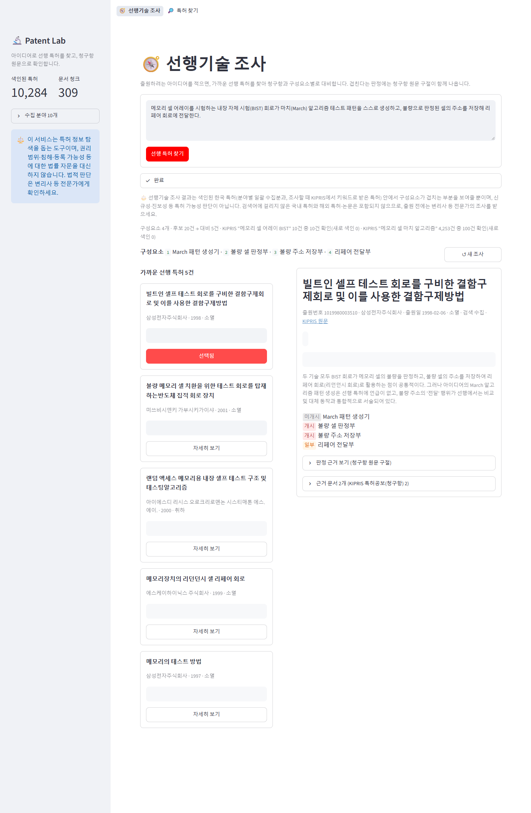
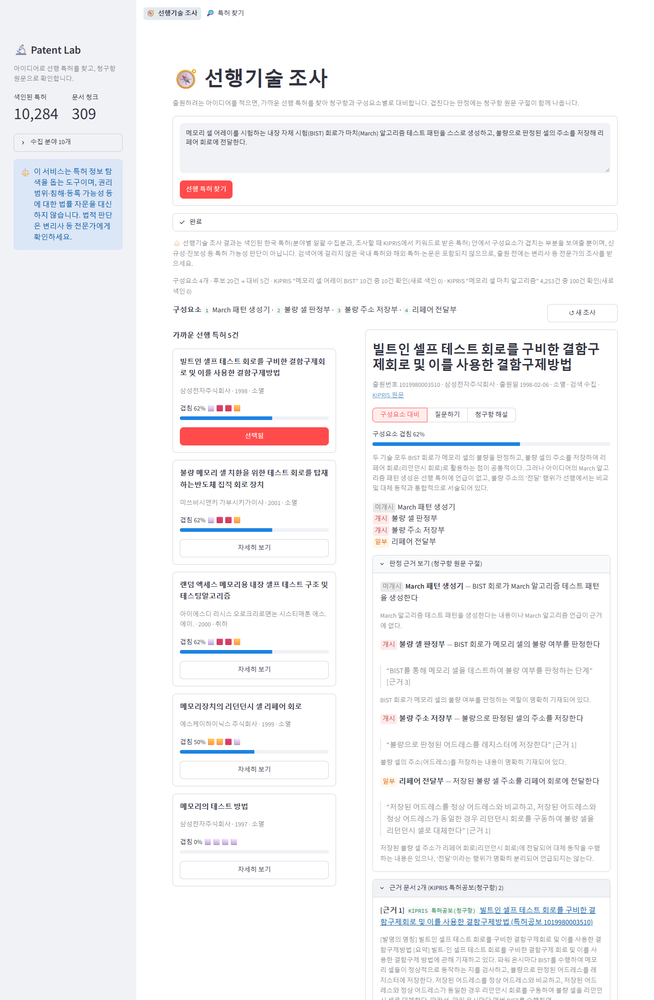
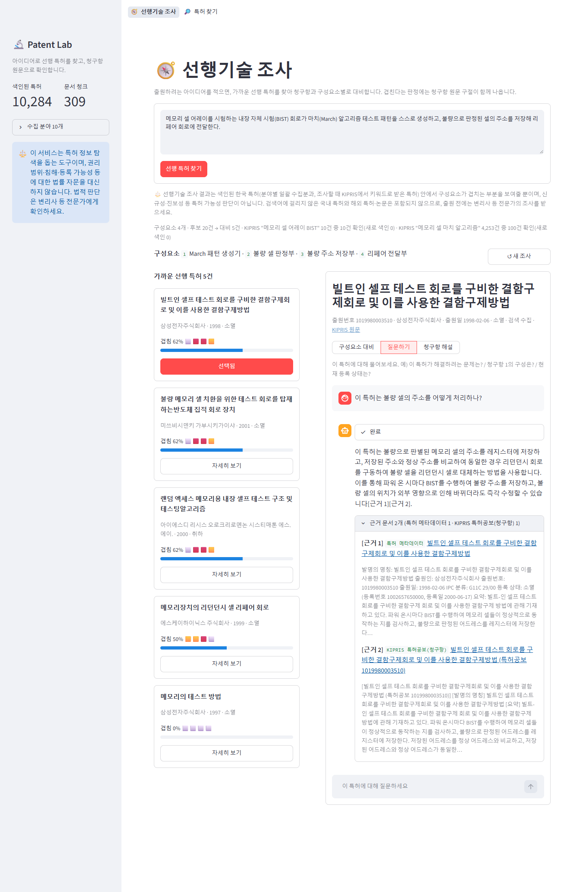

# Patent Lab — 선행기술 조사 RAG

아이디어를 입력하면 가까운 한국 선행 특허를 찾아 **구성요소별로 청구항과 대비**하고, "이미 나와 있다"는 판정마다 **공보 원문(요약·청구항) 구절을 코드로 검증**해 보여 주는 서비스입니다. 특허에 대한 질문은 공보(요약·청구항)와 위키백과에서 찾은 근거만으로 답합니다.

| 선행기술 조사 결과 | 구성요소 대비와 청구항 근거 | 질의응답 답변과 근거 |
|:---:|:---:|:---:|
|  |  |  |

- **데이터**: 한국 특허 10,284건 (반도체 테스트 IPC G01R 31/3183 전체 985건 + 8개 분야 대표 특허 + 조사할 때 KIPRIS 검색으로 더한 1,537건), 특허 공보와 한국어 위키백과
- **스택**: Python · LangGraph · LangChain · Chroma · sentence-transformers(bge-m3) · Gemini(OpenAI 호환 API) · KIPRIS Plus API · Streamlit
- **운영 비용 0원**: LLM은 무료 등급, 임베딩은 로컬 CPU. 저장소에 색인 스냅샷이 들어 있어 clone 뒤 바로 실행됩니다.
- 이 서비스는 특허 정보 탐색을 돕는 도구이며 **법률 자문을 대신하지 않습니다.** 권리 범위·침해·등록 가능성 판단은 변리사 등 전문가에게 확인하세요.

## 왜 만들었나
특허를 출원하며 선행 특허를 조사할 때, 가장 시간이 드는 일은 비슷한 특허를 찾는 것이 아니라 **찾은 특허의 청구항을 하나씩 읽으며 "내 아이디어의 어느 구성이 이미 나와 있는지" 대조하는 것**이었습니다. 청구항은 법률 문장이라 읽기 어렵고, 비슷한 특허가 많아 LLM에 근거 없이 물으면 다른 특허와 섞인 그럴듯한 오답이 나옵니다. 같은 모델에 근거 없이 물었을 때 사실 질문 4개 중 정답 0개, 근거를 붙이면 4개 모두 원문과 일치했습니다 ([실험](docs/experiments/rag_vs_norag.md)).

그래서 이 과정을 그대로 파이프라인으로 옮겼습니다: 아이디어 → 구성요소 분해 → KIPRIS 검색으로 대상 확장 → 가까운 특허 선별 → 청구항 수집 → 구성요소마다 개시/일부/미개시 판정. **판정은 LLM이 인용한 구절이 그 특허의 공보 원문(요약·청구항)에 실제로 있을 때만 인정합니다.**

## 아키텍처
```
선행기술 조사
 아이디어 ─▶ 구성요소 3~6개 ─▶ KIPRIS 키워드 검색 → 새 특허 색인 ─▶ patent_meta MMR 후보 20 ─▶ 선별 5 ─▶ 청구항 수집
                                                └─▶ 구성요소 × 청구항 대비 ─▶ 원문 구절 코드 검증 ─▶ 겹침 비율로 정렬

질의응답 (LangGraph retrieve → generate)
 특허 + 질문 ─▶ 검색어 추출 ─▶ 위키 후보 선별·수집 + 특허 공보(항상) ─▶ 청킹 1,000/200 ─▶ patent_docs
             ─▶ patent_meta 1건 + patent_docs MMR k=5 (특허 범위 필터) ─▶ 근거 블록 ─▶ [근거 n] 달린 답변 ─▶ 인용된 근거만 표시
```
- 2단 색인: `patent_meta`(특허 1건 = 청크 1개, ID = 출원번호) / `patent_docs`(공보·위키 청크, ID = `출원번호:문서ID:순번`, `item_id` 필터로 다른 특허 문서가 섞이지 않게)
- KIPRIS·위키백과 응답은 전부 파일 캐시 + 호출 기록 (LLM 응답은 캐시하지 않음). 색인은 float16 임베딩 스냅샷(23MB)으로 저장소에 포함
- 자세한 설계: [docs/architecture.md](docs/architecture.md)

## 핵심 설계 결정
결정마다 맥락·선택지·결과를 [docs/decisions/](docs/decisions/)에 기록했습니다.

| 결정 | 왜 |
|---|---|
| [청구항 단위 대비](docs/decisions/001-claim-level-comparison.md) | 권리 범위는 요약이 아니라 청구항이 정한다. 실무의 클레임 차트와 같은 형태 |
| [판정에 원문 구절 강제](docs/decisions/002-quote-verification.md) | 거짓 "개시"가 선행 조사에서 가장 위험하다. 인용 구절을 코드로 원문과 대조해 없으면 미개시로 |
| [질의응답 근거는 MMR](docs/decisions/003-mmr-for-qa-evidence.md) | 복합 질문에서 한 문서 청크가 근거를 독점하던 문제. 출처 문서 수 1→3. 선행기술 조사 후보 생성에는 역효과가 측정되어 재검토 중 |
| [색인 스냅샷 공유](docs/decisions/004-index-snapshot.md) | Chroma 약 150MB 대신 23MB 스냅샷, 임베딩 모델을 manifest에 기록해 모델이 다르면 복원 거부 |
| [LLM 제공자 분리 + 로컬 임베딩](docs/decisions/005-free-stack.md) | 운영 비용 0원. LLM은 OpenAI 호환 API 하나로 호출하고 `.env`의 키로 제공자(Gemini·OpenAI)를 고른다. 임베딩은 로컬 bge-m3로 API 호출 없이 1만 건 색인. 429(요청 한도 초과)에 대비해 프로세스 공유 속도 제한(`LLM_RPM`)·재시도·대비 병렬 수를 설정값으로 둔다 |
| [라벨 없는 자동 평가](docs/decisions/006-self-retrieval-eval.md) | 청구항 1을 아이디어로 바꿔 정답을 자기 자신으로 두고 Recall·판정 정확도·비용을 잰다 |
| [사전 수집 + 조사 시 검색 수집](docs/decisions/007-kipris-on-demand.md) | 월 1,000회 한도 안에서 전 분야 조사. 캐시·기록·컬렉션 기준 색인 판단 <!-- TODO: 확인 — src/config.py의 KIPRIS_MONTHLY_LIMIT는 10000(코드에서 쓰이지 않음), 문서는 1,000회 --> |

## 품질 측정
설정을 바꿀 때마다 같은 평가셋으로 돌려 [실험 요약표](docs/eval/prior_art_eval.md)에 한 줄씩 쌓습니다.

**선행기술 조사 자동 평가** — 사람이 라벨링한 정답이 없어, 청구항이 캐시된 특허 40건의 첫 청구항을 LLM이 엔지니어의 아이디어 설명처럼 바꿔 쓴 문장을 입력으로 쓰고 그 특허 자신을 정답으로 둡니다 (청구항과 겹친 가장 긴 구절 중앙값 8자).

| 기준선 (Gemini 3.5 Flash-Lite + bge-m3, 2026-10-24) | 값 |
|---|---|
| Recall@20 (후보) / Recall@5 (대비 대상) / MRR@5 | 88% / 85% / 0.819 |
| 개시율 (정답 특허, 전부 "개시"가 정답) / 개시+일부 | 96% / 97% |
| 겹침 1위율 (동률 포함) | 100% |
| 사례당 시간 · 토큰 · 비용 | 23초 · 4,800 · 0원 |

기준선에서 찍어낸 다음 실험 두 가지 ([해석](docs/eval/prior_art_eval/baseline-flash-lite_2026-10-24.md)):
- 검색 미스 5건 중 2건은 **MMR이 정답을 떨어뜨렸다** (유사도 2위·4위) → 후보 생성을 유사도 검색으로
- 판정 오류 6개 중 4개는 **원문 구절 검증이 맞는 판정을 미개시로 바꿨다** (정답 특허 판정 136개 중 2.9%) → 구절 재탐색 또는 토큰 단위 일치

**그 밖의 실험** — [유사도 vs MMR](docs/experiments/mmr_vs_similarity.md) (출처 문서 수 1→3, 청크 간 겹침 0.866→0.529) · [RAG 전후](docs/experiments/rag_vs_norag.md) (사실 정확성 0/4 → 4/4) · [여러 출처 결합](docs/experiments/multi_source.md). 기능별 검증 결과는 [docs/qa.md](docs/qa.md) (2026-10-22 측정, 당시 설정 gpt-4o-mini·text-embedding-3-small), 요구사항은 [docs/requirements.md](docs/requirements.md).

## 실행
### 준비
- Python 3.12 이상 (개발·검증은 3.14, Windows 11)
- `.env` 값 3개: LLM 키 하나(`GEMINI_API_KEY`([Gemini](https://aistudio.google.com/apikey) 무료 등급) 또는 `OPENAI_API_KEY`, 둘 다 있으면 OpenAI), `KIPRIS_API_KEY`([KIPRIS Plus](https://plus.kipris.or.kr) 서비스 키), `WIKI_CONTACT`(위키백과 User-Agent에 넣을 연락처). LLM 키만 있어도 실행되며, 나머지 둘이 없으면 이미 색인된 특허·문서로만 조사하고 답합니다.
- 선택 설정 (비우면 제공자별 기본값, 뜻과 기본값은 `.env.example` 주석): `OPENAI_BASE_URL`, `CHAT_MODEL`·`PRIOR_ART_MODEL`, `EMBEDDING_PROVIDER`·`EMBEDDING_MODEL`, `LLM_RPM`·`LLM_MAX_RETRIES`·`COMPARE_WORKERS`, `CHROMA_DIR`
- 임베딩은 Gemini 키를 쓰면 기본으로 로컬 모델(bge-m3)을 CPU에서 돌립니다. 처음 실행할 때 모델(약 2.2GB)을 내려받습니다. OpenAI 키를 쓰면 기본값이 OpenAI 임베딩(`text-embedding-3-small`)이 되어 저장소의 스냅샷(bge-m3)을 복원하지 않으므로, 스냅샷을 그대로 쓰려면 `.env`에 `EMBEDDING_PROVIDER=local`을 둡니다.

```bash
python -m venv venv
source venv/Scripts/activate     # Windows Git Bash (macOS/Linux: source venv/bin/activate, Windows cmd: venv\Scripts\activate)
pip install -r requirements.txt
cp .env.example .env             # 값 채우기 (설정 항목은 .env.example 주석 참고)
streamlit run src/ui/app.py --server.address localhost
```
http://localhost:8501 — 처음 실행할 때 색인이 비어 있으면 저장소의 스냅샷으로 색인을 자동 복원합니다 (약 20초, 외부 호출 없음).

**화면**: 상단 메뉴 **선행기술 조사**(기본) · 특허 찾기(조건으로 찾기 / 이름·번호로 찾기). 조사 결과 카드를 고르면 오른쪽 패널에서 **구성요소 대비 · 질문하기 · 청구항 해설**로 이어집니다.

### 데이터와 색인
저장소에는 수집한 특허 데이터(`data/processed`), KIPRIS·위키백과 응답 캐시(`data/raw`), 색인 스냅샷(`data/index`)이 들어 있습니다. 조사·질문으로 특허·문서가 늘어나면 커밋 전에 스냅샷을 갱신합니다.

```bash
python -m src.data_prep.collect_meta             # 처음부터: KIPRIS에서 분야별 메타데이터 수집 (18회 호출, 캐시됨)
python -m src.vectorstore.index_meta             # 메타데이터 색인 (--reset: 지우고 다시)
python -m src.vectorstore.index_docs --rebuild   # 문서 컬렉션을 캐시로 재청킹·재색인 (외부 호출 없음)
python -m src.vectorstore.snapshot export        # 색인 스냅샷 저장 (커밋 전에) / import: 복원
```

**임베딩 모델 바꾸기** — 스냅샷에는 어떤 임베딩 모델로 만든 벡터인지가 기록되어(`data/index/manifest.json`) 설정과 다르면 복원하지 않습니다. 모델을 바꾸면 `index_meta --reset` → `index_docs --rebuild` → `snapshot export` 순서로 다시 만듭니다 (1만 건, CPU에서 건당 약 0.7초)<!-- TODO: 확인 — 0.7초/건(docs/decisions/005)이면 10,284건에 약 2시간. 이전 README는 '수십 분' -->. LLM 요청 한도는 `.env`의 `LLM_RPM`(분당 요청 수)·`LLM_MAX_RETRIES`(재시도)·`COMPARE_WORKERS`(대비 병렬 수)로 조정합니다.

> **Windows 경로 주의**: Chroma는 한글 등 영문이 아닌 문자가 든 절대 경로의 색인 파일을 읽지 못합니다. 프로젝트 루트에서 실행하거나 `.env`에 `CHROMA_DIR=영문 경로`를 지정하세요.

### 평가·점검 명령
```bash
python -m src.service.prior_art "스캔 체인 고장 로그로 학습 데이터를 만들어 고장 셀을 예측하는 진단 방법"   # 선행기술 조사 (CLI)
python -m src.rag.graph --item 1020230136220 --question "지터를 측정하는 원리는?" --show-graph           # 질의응답 + 그래프 구조
python -m src.eval.make_prior_art_cases           # 평가셋 생성 → docs/eval/prior_art_cases.json
python -m src.eval.prior_art_eval --label <이름>  # 자동 평가 → docs/eval/prior_art_eval.md 요약표에 한 줄 추가
python -m src.eval.compare_search --top-k 5       # 유사도 vs MMR 근거 비교
python -m src.eval.rag_vs_norag                   # RAG 전후 답변 생성
python -m src.eval.verify [점검 이름 ...]          # 통합 점검 (실제 색인·LLM·AppTest) → docs/eval/verification_run.md
pytest                                            # 단위 테스트 (LLM·네트워크 없이 실행)
```

## 데이터 출처와 이용 조건
| 데이터 | 출처 | 범위 | 이용 조건과 지킨 방법 |
|---|---|---|---|
| 특허 메타데이터 (명칭·출원인·일자·IPC·상태·요약) | 한국특허정보원 **KIPRIS Plus** Open API `getAdvancedSearch`, `getWordSearch` | 9개 분야 IPC 8,747건 일괄 + 조사 때 키워드 검색으로 받은 특허(검색 1회 최대 100건) | KIPRIS Plus 이용약관과 서비스 키 발급 조건을 따른다. 무료 이용은 월 1,000회 한도<!-- TODO: 확인 — KIPRIS Plus 현재 한도. src/config.py KIPRIS_MONTHLY_LIMIT=10000과 다름 -->라 응답을 캐시하고 모든 호출을 `data/raw/api_calls.log`에 기록한다. **저장소를 공개하거나 배포할 때는 재배포 조건을 먼저 확인한다.** |
| 특허 공보 (요약·청구항) | KIPRIS Plus `getBibliographyDetailInfoSearch` | 질문하거나 조사에서 대비한 특허만. 이 API는 명세서 상세 설명을 주지 않아 요약과 청구항을 공보 문서로 쓴다 | 출원번호별로 한 번만 호출하고 캐시한다. 원문 링크는 특허청 DOI(`https://doi.org/10.8080/<출원번호>`) |
| 기술 개념 문서 | **한국어 위키백과** MediaWiki API | 질문마다 선별된 문서 | 본문은 [CC BY-SA 4.0](https://creativecommons.org/licenses/by-sa/4.0/deed.ko). 근거로 쓸 때 제목과 원문 URL을 표시한다. [위키미디어 User-Agent 정책](https://foundation.wikimedia.org/wiki/Policy:Wikimedia_Foundation_User-Agent_Policy)에 따라 연락처를 보내고 0.5초 간격을 둔다 |

외부 API 키는 `.env`에만 두며 저장소와 화면에 노출하지 않습니다. 전체 커밋 이력에서 키 값이 없음을 확인했습니다.

## 프로젝트 구조
```
src/
├── config.py               # 경로·청킹·검색·모델·제공자·요청 한도 등 조정 가능한 값
├── env.py                  # .env 키 읽기 (제공자 결정), 누락 안내
├── data_prep/              # 데이터 준비 — 도메인(KIPRIS·위키백과)에 묶인 코드는 여기에
│   ├── collect_meta.py     #   특허 메타데이터 수집
│   ├── items.py            #   특허 1건 → 색인 텍스트·메타데이터
│   ├── http.py             #   외부 호출 공통 규칙: 재시도·간격·기록·키 가림
│   ├── kipris.py           #   KIPRIS 호출·응답 파싱, 특허 공보(요약·청구항)
│   ├── patent_search.py    #   조사 때 KIPRIS 키워드 검색으로 특허 추가
│   ├── wiki.py             #   위키백과 검색·본문
│   ├── docs.py             #   외부 문서 형태, 출처 유형 이름
│   └── collect_docs.py     #   검색어 추출·후보 선별로 수집할 문서 결정, 수집 기록
├── vectorstore/            # 색인
│   ├── store.py            #   컬렉션 열기, 임베딩(OpenAI / 로컬 sentence-transformers)
│   ├── index_meta.py       #   메타데이터 색인
│   ├── index_docs.py       #   문서 청킹·색인
│   └── snapshot.py         #   색인 스냅샷 저장·복원 (임베딩 모델 manifest)
├── rag/                    # RAG 파이프라인
│   ├── prompts.py          #   프롬프트, 면책 문구
│   ├── llm.py              #   채팅 모델(요청 속도 제한·재시도), JSON 파싱
│   ├── retriever.py        #   근거 검색·병합
│   ├── citations.py        #   인용 근거 추출
│   └── graph.py            #   LangGraph retrieve → generate
├── service/                # 서비스 기능
│   ├── prior_art.py        #   선행기술 조사 (구성요소 대비, 원문 구절 검증)
│   ├── claim_brief.py      #   청구항 해설
│   └── explore.py          #   조건 기반 탐색, 이름·번호 검색
├── ui/app.py               # Streamlit 화면
└── eval/                   # 평가·점검
    ├── make_prior_art_cases.py, prior_art_eval.py   # 선행기술 조사 자동 평가
    ├── compare_search.py, rag_vs_norag.py            # 실험
    └── verify.py                                     # 통합 점검
tests/                      # 단위 테스트 (LLM·네트워크 없음)
docs/
├── architecture.md         # RAG 파이프라인 설계, 설정값의 이유, 겪은 문제와 해결
├── decisions/              # 설계 결정 기록
├── experiments/            # 실험 결과 (MMR, RAG 전후, 출처 결합)
├── eval/                   # 평가셋, 실험 요약표, 실행별 결과, 실험 원자료, CLI 출력, 통합 점검 원문
├── requirements.md         # 제품 요구사항
├── qa.md                   # 검증 결과
└── screenshots/            # 실행 화면 13장
data/                       # raw: API 응답 캐시 / processed: 특허 JSON·수집 기록 / index: 색인 스냅샷
.env.example                # 설정 항목과 제공자별 기본값 (복사해서 .env로)
.streamlit/config.toml      # 화면에 오류 추적 정보를 보이지 않는 설정
.github/workflows/ci.yml    # push·PR마다 ruff + pytest (Python 3.12, torch·sentence-transformers 없이)
pyproject.toml              # pytest·ruff 설정 (런타임 의존성은 requirements.txt에 버전 고정)
```

## 버전 기록
| 버전 | 날짜 | 주요 변경 | 결과 |
|---|---|---|---|
| v2 | 2026-10-24 | LLM 제공자 분리(`.env`의 키로 Gemini 무료 등급·OpenAI 선택) · 로컬 임베딩 bge-m3로 전체 재색인 · 라벨 없는 자동 평가셋 40사례 · CI(push·PR마다 ruff·pytest) | 운영 비용 0원. 선행기술 조사 기준선 Recall@5 85% · 개시율 96% · 사례당 23초 ([실험 요약표](docs/eval/prior_art_eval.md)) |
| v1 | 2026-10-22 | 질의응답 RAG(LangGraph) · 선행기술 조사(구성요소 × 청구항 대비, 원문 구절 검증) · 청구항 해설 · 특허 찾기. LLM gpt-4o-mini·gpt-4.1, 임베딩 text-embedding-3-small | RAG 전후 사실 정확성 0/4 → 4/4 · MMR로 질의응답 근거 출처 문서 수 1~2 → 3~5(특허 3건) ([검증 결과](docs/qa.md)) |

v1은 SSAFY AI 과정에서 개인 프로젝트로 만들었습니다.

## 한계와 다음 단계
- **판정 엄격도**: 원문 구절 검증이 거짓 개시를 막는 대신 맞는 판정도 약 2.9%(정답 특허 판정 136개 중 4개) 떨어뜨린다. 구절 재탐색·토큰 단위 일치 실험 예정
- **후보 생성의 MMR**: 비슷한 특허끼리 밀어내 정답이 빠지는 사례가 측정됐다. 유사도 검색·BM25 하이브리드 실험 예정
- **평가의 한계**: 정답이 자기 자신인 평가라 검색 상한과 판정 일관성을 재는 것이지 진짜 선행 특허 탐색 능력은 아니다. 외부 정답(심사관 인용 문헌)이 생기면 추가
- **출처 간 분량 불균형**: 위키 문서가 청구항보다 청크 수가 20배 많은 특허에서 근거가 위키로 치우친다. 출처별 근거 수 배분 검토
- **보고서 내보내기**: 구성요소 × 특허 매트릭스(클레임 차트)를 Markdown/PDF로 저장하는 기능

## 라이선스
코드는 [MIT 라이선스](LICENSE), 수집한 특허 데이터는 KIPRIS Plus 이용약관을 따릅니다.
