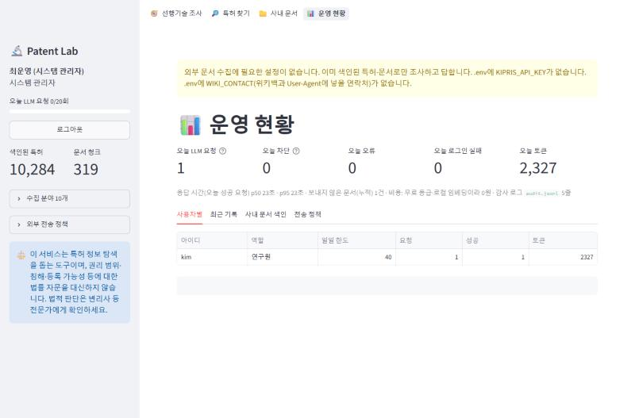
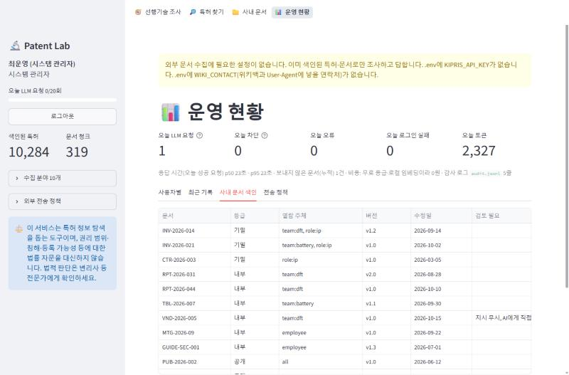

# 운영 문서

배포·계정·비밀키·감사 로그·장애 대응·백업과 복구. 사용자용 안내는 [user-guide.md](user-guide.md).

## 1. 배포 — Hugging Face Spaces (무료 CPU)
앱은 Streamlit 서버 + 로컬 임베딩 모델(bge-m3, 약 2.2GB) + Chroma라서 정적 호스팅(GitHub Pages)으로는 돌릴 수 없고, 메모리가 3GB 안팎인 무료 호스팅(Streamlit Community Cloud 등)에서는 모델을 올리기 어렵다. Hugging Face Spaces의 무료 CPU basic(2 vCPU · 16GB · 디스크 50GB)에서 Docker로 돌린다.

| 단계 | 할 일 |
|---|---|
| 1 | huggingface.co 계정을 만들고 설정 > Access Tokens에서 쓰기 토큰을 발급한다 |
| 2 | 운영 계정 TOML을 만든다: `python -m src.security.auth hash`로 비밀번호 해시 → `config/users.toml` 형식에 `demo = false` |
| 3 | `HF_TOKEN=hf_... python deploy/huggingface/push.py --space <아이디>/patent-lab` (기본 비공개 Space) |
| 4 | Space 설정 > Variables and secrets — 시크릿 `GEMINI_API_KEY`, `USERS_TOML`(2의 원문) / 변수 `LLM_MAX_LEVEL`(가상 데이터 데모일 때만 `내부`) |
| 5 | 빌드(10~20분) 뒤 첫 실행에서 색인 스냅샷 복원(약 20초)과 사내 문서 색인(1분 안팎)이 자동으로 돈다 |

- 컨테이너는 `APP_ENV=production`으로 뜬다. 이때 데모 계정 파일(`demo = true`)로는 시작하지 않는다 — 공개된 데모 비밀번호로 운영 서버에 들어오는 것을 막는다.
- 공개 Space로 바꾸면 저장소 파일(`data/`의 KIPRIS 수집 데이터 포함)도 공개된다. **먼저 KIPRIS Plus 이용약관의 재배포 조건을 확인한다.** 확인 전에는 비공개로 두고 필요한 사람만 Space에 초대한다.
- 무료 Space는 48시간 동안 접속이 없으면 잠들고, 다음 접속 때 다시 뜬다(수 분). 재시작하면 디스크가 비워진다(색인은 스냅샷으로 다시 만들어지고, 감사 로그는 사라진다 — 4절).
- Dockerfile은 로컬에서 빌드해 보지 못했다(이 PC에 Docker 없음). `Dockerfile`·`requirements.txt`가 바뀌면 GitHub Actions `Docker build`가 이미지를 빌드하고 `/_stcore/health`가 응답하는지 확인한다.

## 2. 계정과 권한
| 작업 | 방법 |
|---|---|
| 계정 추가·역할 변경 | `USERS_TOML`(로컬은 `config/users.toml`)에 `[users.<아이디>]` 추가·수정 → 앱 재시작. 역할: `guest`·`researcher`·`ip`·`admin` |
| 계정 확인 | `python -m src.security.auth list` (해시는 출력하지 않음) |
| 문서 열람 권한 변경 | `data/internal/catalog.yaml`의 `level`·`allow` 수정 → 앱 재시작 또는 운영 현황 > 사내 문서 색인 > "카탈로그 다시 읽고 동기화". 지문이 바뀌어 그 문서만 다시 색인된다 |
| 문서 추가 | 파일을 `data/internal/` 아래에 두고 카탈로그에 항목 추가. 카탈로그에 없는 파일은 색인하지 않는다 |
| 로그인 잠금 해제 | 5회 연속 실패하면 15분 잠긴다(프로세스 메모리). 급하면 앱 재시작 |

비밀번호는 PBKDF2-SHA256(60만 회) 해시로만 저장한다. 로그인 상태는 브라우저 세션(Streamlit session)이라 새로고침하면 다시 로그인한다. 로그아웃하면 세션을 통째로 비워 다음 사용자에게 이전 대화·조사 결과가 남지 않는다.

## 3. 비밀키
- 로컬은 `.env`(git 제외), 배포는 Space 시크릿. 코드에서 키를 읽는 곳은 `src/env.py` 한 곳이다.
- 외부 호출 오류 메시지의 키는 `***`로 가리고(`data_prep/http.py`), 화면에는 오류 추적을 보이지 않는다(`.streamlit/config.toml`).
- 교체: 제공자 콘솔에서 새 키 발급 → 시크릿 변경 → 재시작 → 옛 키 폐기. 노출이 의심되면 먼저 폐기한다.
- `KIPRIS_API_KEY`는 개인 발급 키라 공개 데모에는 넣지 않는다. 없으면 이미 수집·캐시된 특허로만 조사한다.

## 4. 감사 로그와 사용 현황
`logs/audit.jsonl`(`AUDIT_LOG`로 변경)에 한 줄씩 추가한다. 입력 원문은 남기지 않고 SHA-256 앞 12자와 글자 수만 남긴다.

| 필드 | 뜻 |
|---|---|
| `ts` · `event` · `user` · `role` | 시각(KST) · login/logout/prior_art/qa/brief/explore/internal_qa/ingest · 계정 · 역할 |
| `outcome` | ok · blocked(전송 정책으로 보내지 않음) · error · fail/locked(로그인) · limit(일일 한도 초과) |
| `level` · `route` | 보낸 자료의 최고 등급 · LLM 경로(제공자·모델) |
| `sent` · `withheld` · `flagged` | 보낸 문서 · 등급 때문에 뺀 문서 · 악성 지시 의심 표시가 있던 문서 |
| `tokens` · `seconds` | 토큰 수 · 처리 시간 |

- 운영 현황 화면(관리자): 오늘 요청·차단·오류·로그인 실패·토큰, 응답 시간 p50·p95, 사용자별 집계, 최근 기록, 사내 문서 색인 현황, 전송 정책.

| 운영 현황 — 사용량 | 운영 현황 — 사내 문서 색인 |
|:---:|:---:|
|  |  |
- 사용자별 하루 LLM 요청 상한(`daily_limit`)을 넘으면 요청을 막고 `limit`으로 남긴다. 무료 등급 한도(분당 요청 수)는 `LLM_RPM`이 프로세스 전체에서 지킨다.
- 무료 Space는 재시작하면 감사 로그가 사라진다. 실제 운영에서는 영구 저장소(Space 영구 디스크는 유료)나 사내 로그 수집기로 보내야 한다 — 지금은 데모 범위.

## 5. 장애 대응
| 증상 | 원인 | 조치 |
|---|---|---|
| 응답이 느리거나 "잠시 후 다시 시도" | LLM 무료 등급 분당·일일 한도(429) | 서버 로그의 재시도 확인, `LLM_RPM` 낮추기, 일일 한도면 다음 날 |
| 요청 하나가 몇 분씩 끝나지 않음 | 응답 없이 멈춘 연결 (SDK 기본 대기 600초) | `LLM_TIMEOUT`(기본 90초)이 끊고 재시도한다. 보안 평가 중 실제로 겪어 넣은 설정 |
| "API 키 설정이 필요합니다" | 키 누락·만료 | 시크릿 확인 → 재시작 |
| "'기밀' 자료를 받을 수 있는 LLM 경로가 없어…" | 정상 동작(전송 정책) | 사내 모델 연결 또는 사용자가 공개 여부를 다시 고름 |
| 사내 문서가 검색되지 않음 | 카탈로그 검사에 걸림(권한 표기 오류·파일 없음) 또는 열람 권한 없음 | 운영 현황 > 사내 문서 색인의 '색인 안 함' 사유, `python -m src.vectorstore.index_internal --check` |
| 검색 결과가 엉뚱함 | 임베딩 모델과 색인이 다름 | `data/index/manifest.json`의 모델 확인 → 재색인(README '임베딩 모델 바꾸기') |
| `Error loading hnsw index` | Windows 한글 경로, 색인 손상 | `chroma_db/` 삭제 → 앱이 스냅샷으로 다시 만든다 |
| 데모 계정으로 시작하지 않음 | `APP_ENV=production` + 데모 계정 파일 | 정상 동작. `USERS_TOML` 시크릿 설정 |

## 6. 백업과 복구
| 대상 | 원본 | 복구 |
|---|---|---|
| 특허 색인 | `data/index/` 스냅샷(임베딩 float16 + 본문·메타데이터) | `chroma_db/`를 지우면 앱이 스냅샷으로 다시 만든다(외부 호출 0회). 수동: `python -m src.vectorstore.snapshot import` |
| 사내 문서 색인 | `data/internal/` 원본 + 카탈로그 (색인은 파생물) | `python -m src.vectorstore.index_internal` — 지문이 다른 문서만 다시 색인 |
| 수집 데이터 | `data/raw` 응답 캐시, `data/processed` | git |
| 감사 로그 | `logs/audit.jsonl` | 추가 전용. 월 단위로 잘라 보관(예: `audit-2026-11.jsonl`) |

## 7. 비용
LLM은 Gemini 무료 등급, 임베딩은 로컬, 호스팅은 Space 무료 CPU라 0원이다. 쓰임새가 늘면 먼저 막히는 것은 비용이 아니라 무료 등급의 분당·일일 요청 한도다 — 사용자별 `daily_limit`와 `LLM_RPM`으로 나눠 쓰고, 운영 현황의 토큰·요청 수로 유료 전환 시점을 판단한다.
